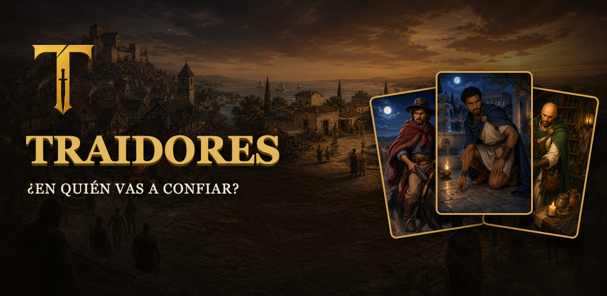
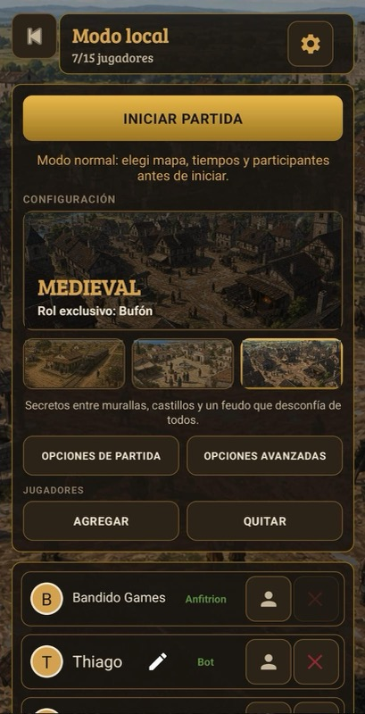
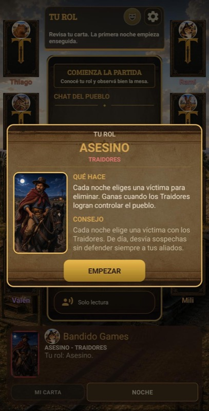
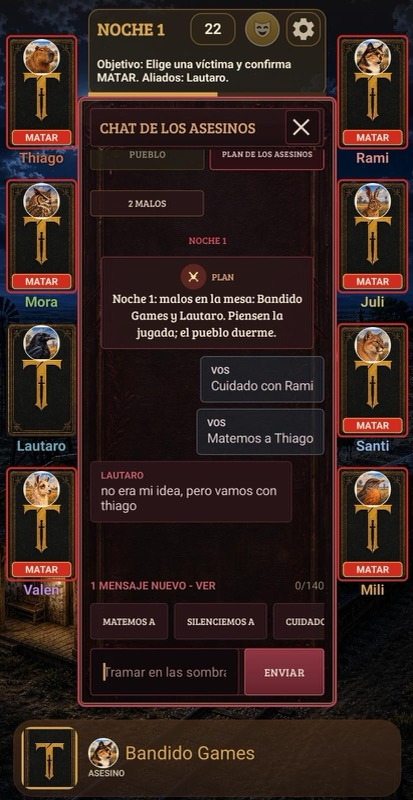
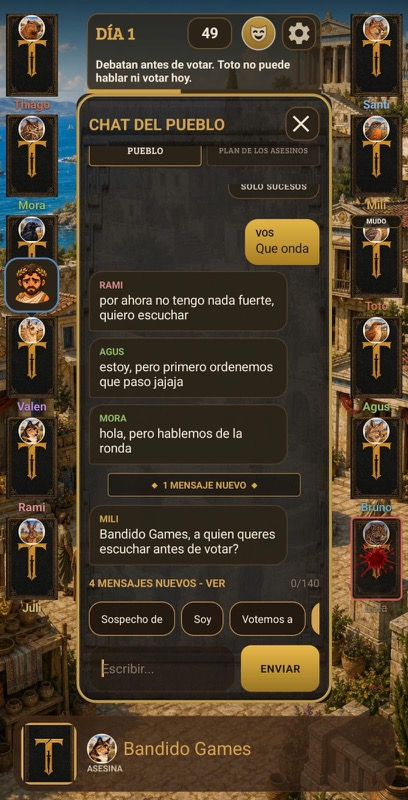
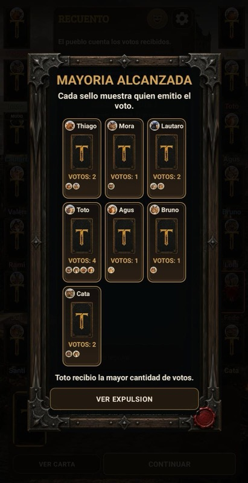
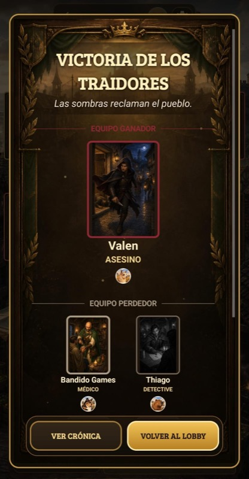
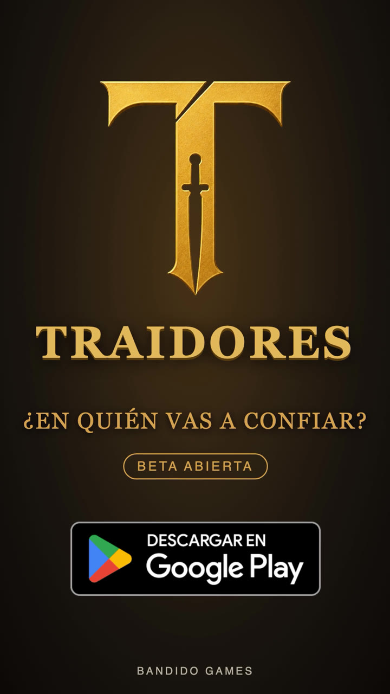
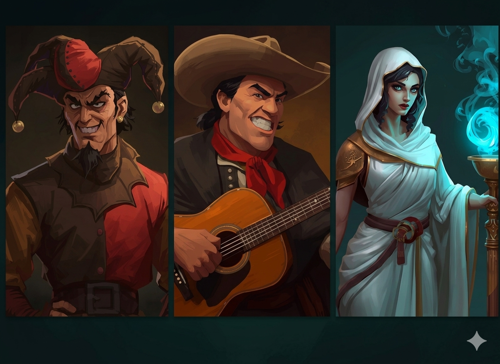

  

  
  

# TRAIDORES

Juego móvil de **deducción social** para Android. Cada jugador recibe una carta secreta: de noche los traidores eligen a quién eliminar, de día el pueblo debate, sospecha y vota. Nadie es quien dice ser.

> **Estado:** beta abierta en Google Play · iOS en desarrollo.
> Este repositorio es una **vitrina** del proyecto: capturas, decisiones de diseño y documentación. El código del juego es privado.

## Cómo se juega

1. **Carta secreta.** Cada uno recibe un rol y lo descubre dándolo vuelta.
2. **Noche.** Los Asesinos se ponen de acuerdo en un chat privado y eligen a su víctima. Los roles especiales usan su habilidad.
3. **Amanecer.** Se anuncia quién cayó (o si alguien fue salvado).
4. **Debate.** Todos hablan, acusan y defienden. También hay emotes en la mesa.
5. **Votación.** El pueblo expulsa a un sospechoso y se revela su carta.
6. **Victoria.** Gana el Pueblo si elimina a los traidores, y ganan los Traidores si controlan la aldea.

## Capturas

  
  
  

  
  
  

## Tráiler

## Mapas y roles

Tres mapas (**Pampa**, **Grecia** y **Medieval**), cada uno con su ambientación. Desde 8 jugadores aparecen **roles propios de cada mapa** con una jugabilidad distinta, como el **Payador** y el **Oráculo**, además del **Bufón**, que gana de una forma especial.

  

## Lo técnico

| Área | Tecnologías |
|---|---|
| App | Kotlin, Android |
| Backend | Firebase: Authentication, Cloud Firestore, Realtime Database, Cloud Functions, Storage |
| Calidad | Crashlytics, Analytics, pruebas unitarias |
| Servicios | Google Play Games, Cloud Messaging, AdMob con consentimiento (UMP), Play Billing |
| Web | HTML, CSS y JavaScript, desplegada en Vercel |

Algunas decisiones de diseño:
- **Partidas online resistentes:** el juego sigue avanzando aunque un teléfono se trabe o se caiga.
- **Bots con chat propio**, para poder jugar una partida completa sin otras personas.
- **Información secreta:** cada jugador solo recibe los datos de su propio rol.
- **Privacidad:** política publicada, cuenta eliminable desde la app y declaraciones de Google Play alineadas con lo que realmente hace la app.

## Documentación

Historias de usuario, análisis y diseño, diagramas de secuencia y de estados, DER y mapeo ORM: [Documentacion-Proyecto-Objetos](https://github.com/nachogimenez7/Documentacion-Proyecto-Objetos).

## Autor

**Ignacio Giménez** · estudiante de Desarrollo de Software · [LinkedIn](https://www.linkedin.com/in/ignaciogimenez7) · [traidores.me](https://www.traidores.me)

Hecho en Argentina por **Bandido Games** 🇦🇷
